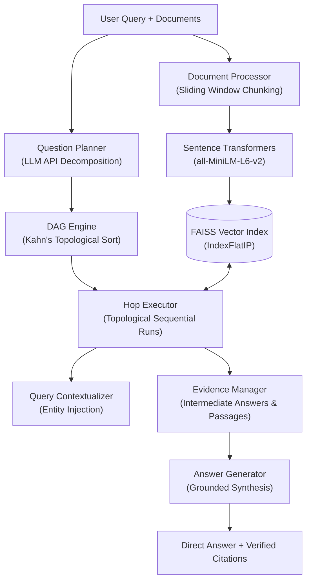
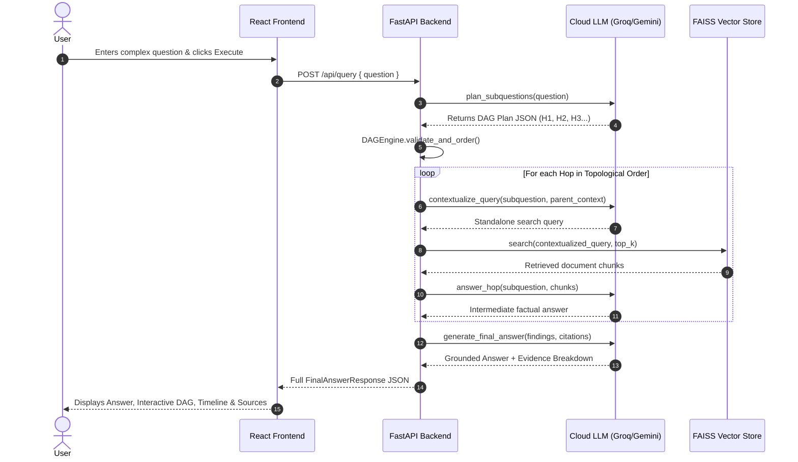

# Project Report: Multi-Hop RAG System with DAG Question Planning

---

## 1. Executive Summary

Standard Retrieval-Augmented Generation (RAG) systems operate on a single-turn retrieval paradigm: given a user query, they compute an embedding, retrieve the top-$k$ nearest document chunks, and synthesize an answer. While effective for simple, direct factual lookups, this approach fails on **complex, multi-hop queries** where:
- The initial question does not contain the entities needed to retrieve the final answer (e.g., *"Which university did the CEO of the company that acquired LinkedIn graduate from?"*).
- Multiple prerequisite pieces of evidence must be discovered sequentially or in parallel across different documents.
- Information from an earlier discovery must be propagated forward to contextualize downstream searches.

This project delivers a **Multi-Hop RAG System** powered by dynamic **Directed Acyclic Graph (DAG) question planning**, local vector search, and API-driven grounded reasoning. Complex questions are decomposed into atomic, topologically ordered dependency graphs, executed sequentially with context passing, and synthesized into a grounded answer with verified source citations.

---

## 2. Core Architectural Overview

The repository is structured into two self-contained directories: **`backend/`** (FastAPI, FAISS, Sentence Transformers) and **`frontend/`** (React, Vite, SVG Graph Engine).

```
├── backend/                  # API & Retrieval Engine
│   ├── main.py               # REST API endpoints & lifecycle management
│   ├── models.py             # Pydantic data contracts & schemas
│   ├── llm_client.py         # Pure API client with dynamic model discovery
│   ├── vector_store.py       # FAISS IndexFlatIP + SentenceTransformers
│   ├── document_processor.py # Hierarchical text chunker with sliding overlap
│   ├── dag_engine.py         # Kahn's topological sort & cycle validation
│   ├── question_planner.py   # Query decomposition orchestrator
│   ├── hop_executor.py       # Topological sequential hop executor
│   ├── evidence_manager.py   # Evidence aggregation & citation builder
│   ├── answer_generator.py   # Grounded response synthesizer
│   ├── run_backend.py        # Uvicorn server launcher
│   └── requirements.txt      # Python dependencies
│
├── frontend/                 # User Interface
│   ├── src/
│   │   ├── App.jsx           # Main dashboard & pipeline coordinator
│   │   ├── components/
│   │   │   ├── DAGVisualizer.jsx   # SVG interactive dependency graph
│   │   │   ├── HopTimeline.jsx     # Step-by-step execution inspector
│   │   │   ├── EvidenceView.jsx    # Source citations & match scores
│   │   │   └── SettingsModal.jsx   # Provider & retrieval configuration
│   │   └── index.css         # Theme styling & layout variables
│   └── package.json          # Node dependencies
│
├── start.bat                 # One-click Windows CMD launcher
├── start.ps1                 # One-click Windows PowerShell launcher
└── README.md                 # System documentation & usage guide
```

---

## 3. System Architecture & Component Breakdown



### 3.1 Document Ingestion & Vector Storage
* **Hierarchical Chunking (`document_processor.py`)**: Documents are split along natural structural boundaries (paragraphs $\to$ sentences $\to$ words) using a sliding window (default 500 characters, 100 character overlap).
* **Local Embedding Generation (`vector_store.py`)**: Text chunks are embedded locally using `all-MiniLM-L6-v2` into normalized 384-dimensional dense vectors. Because embeddings run locally, no third-party rate limits or external embedding costs are incurred.
* **Vector Indexing (`vector_store.py`)**: Uses FAISS (`IndexFlatIP`) for inner product similarity search, which is equivalent to cosine similarity on normalized vectors. Synchronized metadata maps each vector back to its source document filename, chunk index, and character spans.

### 3.2 Dynamic Question Planning (`question_planner.py` & `llm_client.py`)
Instead of guessing queries upfront, the system instructs an LLM to decompose the user's inquiry into an explicit dependency chain of atomic hops.
* Each hop resolves exactly **one entity, organization, person, or attribute**.
* Every hop defines an `id` (e.g. `H1`, `H2`), `question`, `depends_on` (prerequisite hop IDs), and a `purpose`.
* Generates a `final_answer_instruction` specifying how downstream outputs resolve the overarching question.

### 3.3 Graph Engine (`dag_engine.py`)
* Implements **Kahn's Algorithm** for topological sorting.
* Calculates execution levels for multi-stage visual rendering.
* Validates reference integrity and detects cycles ($O(V + E)$ complexity).
* Automatically sanitizes and linearizes any malformed graph outputs into an executable sequence.

### 3.4 Sequential Hop Execution (`hop_executor.py`)
Hops execute along the topological sort order:
1. **Context Extraction**: Gathers intermediate answers and evidence from prerequisite parent hops.
2. **Query Contextualization**: Calls the LLM to rewrite the subquestion into a concrete, standalone vector search query by substituting pronouns or references (e.g. *"the company in H1"* $\to$ *"Microsoft Corporation"*).
3. **Similarity Search**: Performs top-$k$ FAISS search using the contextualized query.
4. **Intermediate Reasoning**: Produces an intermediate answer strictly based on the retrieved document passages.
5. **Evidence Commitment**: Saves results and retrieved passages into the `EvidenceManager`.

### 3.5 Grounded Answer Generation (`answer_generator.py`)
To prevent hallucinations:
* The LLM is provided only with the intermediate hop answers and the exact retrieved passages.
* The prompt strictly enforces that no external training knowledge may be introduced.
* The response is structured into:
  1. **Answer**: Direct, unambiguous answer to the prompt.
  2. **Evidence Chain**: Numbered reasoning breakdown linking each discovery to source citations with chunk indices and similarity scores.

### 3.6 Multi-Provider API Client (`llm_client.py`)
The system connects directly to cloud LLM APIs without relying on brittle local mock heuristics:
* **Groq API**: High-speed LPU inference with `llama-3.1-8b-instant`.
* **Google Gemini API**: Native support for `gemini-2.5-flash`.
* **OpenAI API**: Support for `gpt-4o-mini` and `gpt-4o`.
* **Custom OpenAI-Compatible**: Support for local or self-hosted servers (Ollama, vLLM, LocalAI).
* **Dynamic Active Model Auto-Discovery**: If an API provider returns a 404 (model deprecated or retired), the client dynamically calls the provider's `/models` endpoint to query accessible models for that key, auto-selects an active chat model, and retries the request seamlessly.

---

## 4. End-to-End Execution Sequence



---

## 5. Key Engineering Challenges Solved

| Challenge | Root Cause | Solution Implemented |
| :--- | :--- | :--- |
| **Model Deprecation 404s** | Fast-changing cloud model tags (e.g. `gemini-2.0-flash` or `llama-3.3-70b-versatile` decommissioned on free tiers). | Built dynamic `ModelService` auto-discovery that queries live `/models` endpoints on 404, selects an active model, and caches it. |
| **Entity Loss Across Hops** | Vector search fails when queries contain indirect references like *"the company in H1"*. | Category-aware query contextualization injects concrete named entities into downstream queries before vector similarity search. |
| **Index Desynchronization** | FAISS index vector count and metadata array drifting apart after document modifications. | Added validation and auto-rebuild checks in `VectorStore.search` ensuring $N_{\text{total}} == \text{len}(\text{chunks})$. |
| **UI Cognitive Overload** | Excessive text, dark neon glows, and redundant technical badges distracting from core tasks. | Redesigned to a minimal white & slate-blue theme; removed unnecessary badges, logs, and sample buttons; retained clean visual graph representation. |

---

## 6. How to Run & Verify

### Prerequisites
* Python 3.10+
* Node.js 18+

### Setup Commands
```bash
# 1. Start the Backend
cd backend
pip install -r requirements.txt
python main.py

# 2. Start the Frontend (in a separate terminal)
cd frontend
npm install
npm run dev
```

### Windows One-Click
```cmd
start.bat
```

Open `http://localhost:5173`, configure your API key in **Settings**, upload documents, and run queries.
